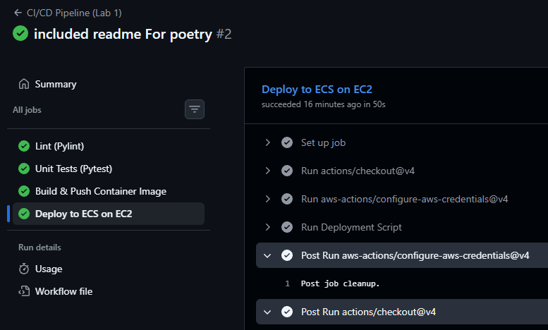
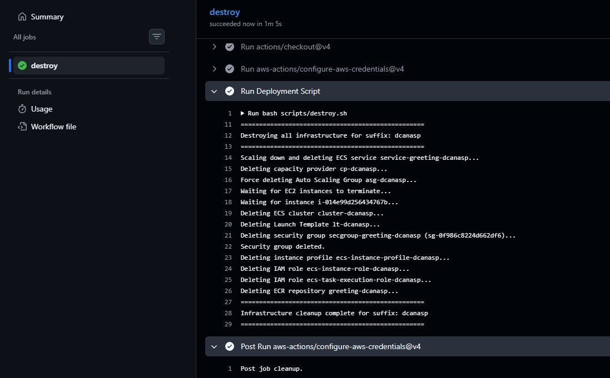
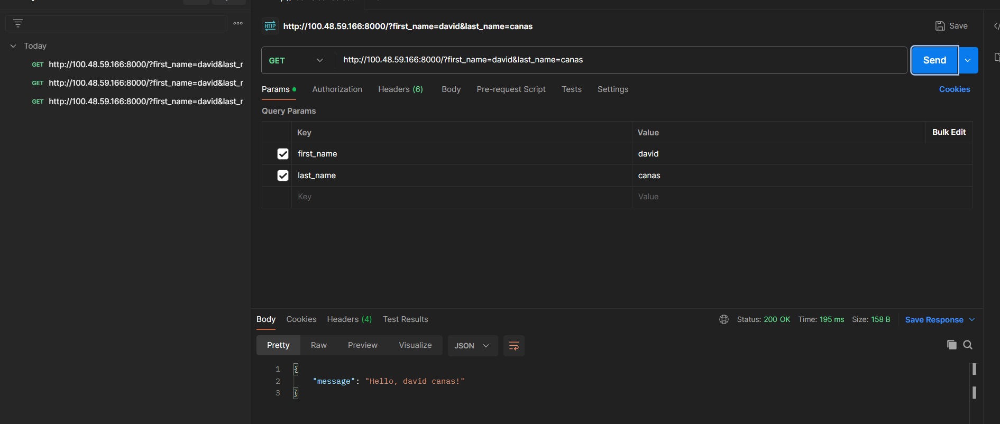
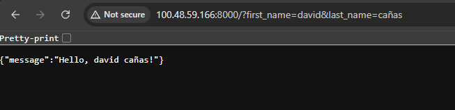
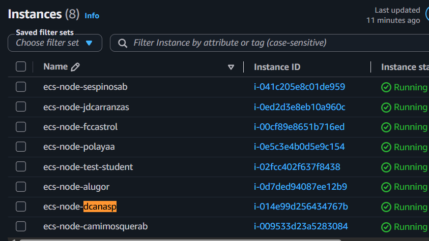
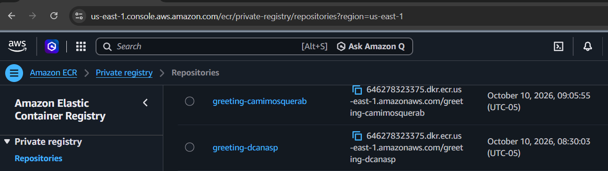

# 1.
Para este laboratorio se utilizan contenedores para poder construir y ejecutar la imagen correctamente. Despues de verificar que el codigo a construir sea correcto (este linteado y pase sus pruebas) se construye este contenedor

El siguiente paso es tener el registro de los artifactor OCI-compliant. al ser creado se va a hacer un push de esa image (con el tag de el hash del commit)

# 2.

# 3. 

# 4. 

el build y push tiene complejidad extra `if: (github.ref == 'refs/heads/main...` que se utiliza para que se use el mismo pipeline en push y pull request, pero que no haga deployment en push request.

Esto hace que el pipeline sea confuso y dificil de mantener. Seria mejor tener linting y build push como pipelines distintos (ya que tienen propositos distintos)

